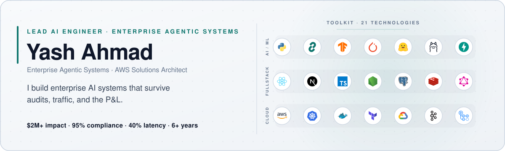

<picture>
  <source media="(prefers-color-scheme: dark)" srcset="assets/hero-dark.svg">
  
</picture>

[LinkedIn](https://www.linkedin.com/in/yashahmad/) · [Email](mailto:yash.ahd786@gmail.com)

---

Most enterprise AI dies between the demo and the audit. I design for that gap.

I'm a Lead AI Engineer and AWS Certified Solutions Architect with 6+ years building distributed systems and production GenAI. I take agentic workflows, sovereign RAG, and cloud-native platforms from architecture to regulated production — with isolation, traceability, and unit economics designed in.

> **Currently:** leading an enterprise agent management platform and an Agent-as-a-Service control plane.

### What I do

- **Agentic platforms** — Multi-tenant orchestration, MCP tool integration, authorization, traceability, and audit trails for agents in regulated environments.
- **Sovereign RAG** — Tenant-isolated retrieval, vector strategy, and latency/cost optimization at 1,000+ concurrent requests per day.
- **Cloud-native architecture** — AWS and Kubernetes platforms with fault isolation, observability, CI/CD, and measurable reliability gains.

### Selected work

#### Enterprise agent management platform
Gave non-technical teams a governed way to define, deploy, and monitor AI agents on Bedrock and LangChain — with authorization, traceability, and audit protocols built for regulated environments.

#### Agent-as-a-Service control plane
Architected a multi-tenant execution plane using FastAPI, isolated Lambda sandboxes, Strands Agents SDK, and MCP-connected CloudWatch logs for automated root-cause diagnostics.

#### Sovereign RAG at scale
Designed distributed LLM pipelines for 1,000+ concurrent daily requests. Improved contextual accuracy 35% and reduced response latency 40%.

#### Regulated document generation
Automated PLPS, ICF, and CSR generation with fine-tuned LLMs — preserving semantic accuracy and compliance while cutting manual processing time 95%.

*Also:* multi-tenant RAG SaaS over course PDFs — FastAPI/React on AWS serverless, per-tenant S3 Vectors, Cognito RBAC, Stripe metering, SSE streaming, 370+ tests.

### How I build

- **Autonomy with accountability.** Every agent action is authorized, traceable, and isolated. Auditability is an architecture requirement, not a logging afterthought.
- **Retrieval is a system, not a prompt.** Evaluation, tenant isolation, and vector strategy are engineered. That's how accuracy goes up 35% while latency goes down 40%.
- **Production economics matter.** Latency, observability, MTTR, and cost per request belong in the design review, not the cleanup.

### Stack

- **AI & agents** — Bedrock · LangChain · Strands SDK · MCP · AgentCore · RAG
- **Cloud & platform** — AWS (EKS, ECS, Lambda) · GCP · Kubernetes · Terraform · Docker
- **Data & observability** — Kafka · Redis · PostgreSQL · Prometheus · Grafana
- **Languages** — Python · TypeScript · Java · SQL · Bash
- **Product** — FastAPI · React · Next.js · GraphQL · gRPC

### Background

B.Tech in Computer Science & Engineering · AWS Certified Solutions Architect – Associate & Professional · Smart India Hackathon runner-up

---

### Work with me

**Hiring?** I'm open to Lead/Staff AI Engineer and AI Architect roles where agents, RAG, or GenAI platforms have to work in regulated production.

**Advising?** I take on agent architecture reviews, RAG evaluation, Bedrock cost/latency audits, and AaaS control-plane design.

→ [yash.ahd786@gmail.com](mailto:yash.ahd786@gmail.com) · [linkedin.com/in/yashahmad](https://www.linkedin.com/in/yashahmad/)
